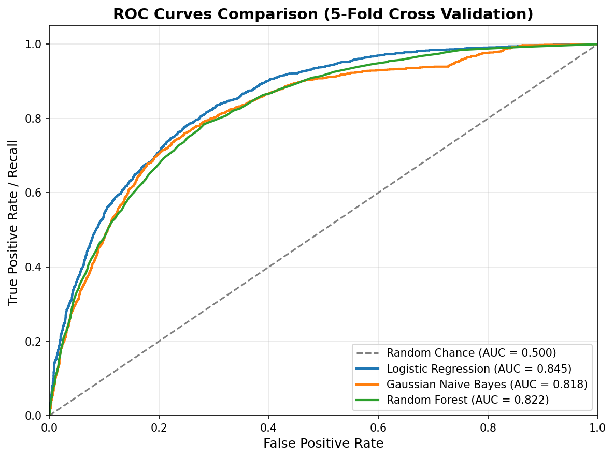
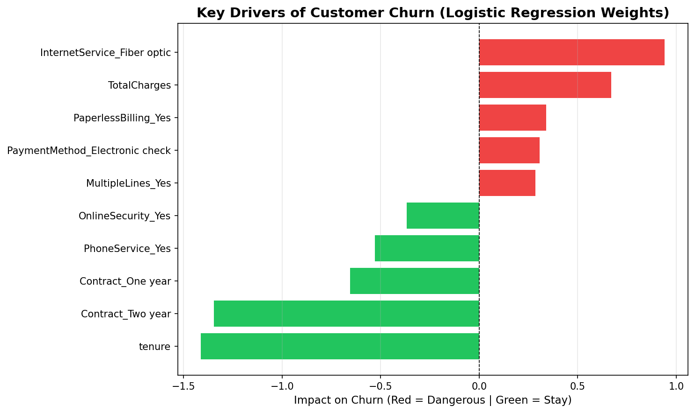

# Telco Customer Churn Prediction

ทำนายว่าลูกค้าค่ายโทรคมนาคมจะ **ยกเลิกบริการ (Churn)** หรือไม่ และหาว่าปัจจัยใดทำให้ลูกค้าย้ายค่าย
โดยเปรียบเทียบ 3 โมเดล: **Logistic Regression**, **Gaussian Naive Bayes** และ **Random Forest**

## ไฟล์ในโปรเจกต์

| ไฟล์ | รายละเอียด |
|---|---|
| [`Data_Telco_Customer_Churn.ipynb`](Data_Telco_Customer_Churn.ipynb) | Notebook หลัก: ทำความสะอาดข้อมูล → สร้างโมเดล → Cross Validation → ROC → ปัจจัยสำคัญ → สรุป |
| [`WA_Fn-UseC_-Telco-Customer-Churn.csv`](WA_Fn-UseC_-Telco-Customer-Churn.csv) | ชุดข้อมูล [IBM Telco Customer Churn](https://www.kaggle.com/datasets/blastchar/telco-customer-churn) (7,043 ราย) |
| [`index.html`](index.html) | เว็บสาธิตแบบโต้ตอบ แสดงการทำงานของ Naive Bayes ทีละขั้นตอน |
| [`images/`](images) | กราฟผลลัพธ์จาก notebook |

## ข้อมูล

- 7,043 ราย, 19 ตัวแปรอิสระ (ข้อมูลประชากร บริการที่ใช้ สัญญา วิธีชำระเงิน ค่าบริการ)
- ตัวแปรเป้าหมาย `Churn` — ลูกค้าที่ยกเลิก ≈ **26.5%** (ข้อมูลไม่สมดุล)
- `TotalCharges` มีค่าว่าง 11 แถว (ลูกค้าใหม่ `tenure = 0`) → เติมด้วยค่ามัธยฐาน

## วิธีการ

1. ปรับสเกลตัวแปรตัวเลขด้วย `StandardScaler` และแปลงตัวแปรหมวดหมู่ด้วย `OneHotEncoder`
2. รวมการแปลงข้อมูลและโมเดลไว้ใน `Pipeline` เพื่อป้องกัน data leakage
3. ประเมินด้วย **Stratified 5-Fold Cross Validation** โดยดู Recall, F1-Score และ ROC-AUC (ไม่ใช้ Accuracy เพราะข้อมูลไม่สมดุล)

## ผลลัพธ์

| โมเดล | Recall | F1-Score | ROC-AUC |
|---|---|---|---|
| **Logistic Regression** | 0.553 | **0.602** | **0.845** |
| Gaussian Naive Bayes | **0.875** | 0.580 | 0.820 |
| Random Forest | 0.483 | 0.547 | 0.822 |

- **Logistic Regression** ดีที่สุดโดยรวม (F1 และ ROC-AUC สูงสุด) และตีความได้ง่าย
- **Naive Bayes** จับลูกค้าที่จะย้ายได้มากที่สุด (Recall 0.875) แต่แลกกับการแจ้งเตือนผิดที่มากขึ้น



## ปัจจัยที่มีผลต่อการ Churn



- 🔴 **เพิ่มโอกาส Churn:** อินเทอร์เน็ต Fiber optic, TotalCharges สูง, Paperless Billing, จ่ายด้วย Electronic check, มีหลายเบอร์
- 🟢 **ช่วยรั้งลูกค้า:** `tenure` ยาว, สัญญา 2 ปี / 1 ปี, มีบริการโทรศัพท์, มี Online Security

**ข้อเสนอแนะ:** ชวนลูกค้ารายเดือนเปลี่ยนเป็นสัญญาระยะยาว, ดูแลลูกค้าใหม่และลูกค้า Fiber optic เป็นพิเศษ, และแนะนำบริการ Online Security

## วิธีรัน

```bash
pip install -r requirements.txt
jupyter notebook Data_Telco_Customer_Churn.ipynb
```

หรือเปิดบน Google Colab แล้วอัปโหลดไฟล์ CSV ไว้ในโฟลเดอร์เดียวกับ notebook

เว็บสาธิต Naive Bayes เปิดได้โดยดับเบิลคลิก `index.html` ในเบราว์เซอร์
